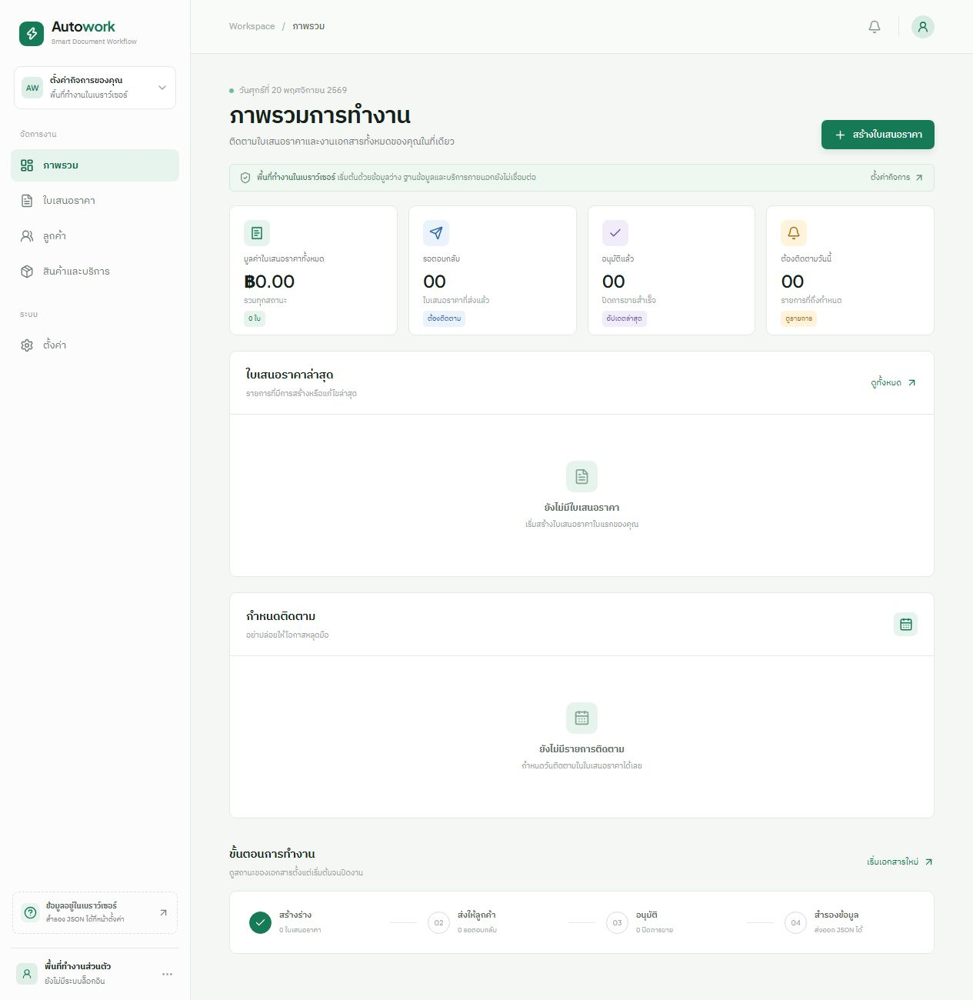
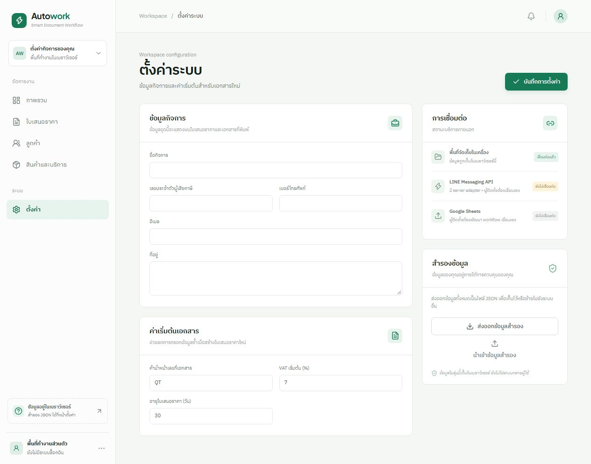

# Smart Document Workflow

`smart-document-workflow` คือ starter สำหรับระบบใบเสนอราคาและติดตามลูกค้า หน้าจอภาษาไทย สร้างด้วย React + Vite เริ่มต้นด้วยรายการลูกค้า สินค้า ใบเสนอราคา และข้อมูลกิจการว่าง ผู้ใช้ต้องกรอกข้อมูลของตนเองก่อนออกเอกสาร

เว็บแอปปัจจุบันเก็บข้อมูลใน `localStorage` ของเบราว์เซอร์ **ยังไม่ได้เชื่อมฐานข้อมูลหรือ backend** ผู้ติดตั้งต้องจัดเตรียม backend ฐานข้อมูล การยืนยันตัวตน และบริการภายนอกของตนเองก่อนเปิดใช้ร่วมกันในธุรกิจ

## ภาพหน้าจอ

ภาพจากแอปในสถานะเริ่มต้นที่ไม่มีข้อมูลตัวอย่าง





## เริ่มใช้งานในเครื่อง

ติดตั้ง Node.js 22 ขึ้นไปและ npm แล้วเปิด Terminal ที่โฟลเดอร์โปรเจกต์:

```powershell
npm ci
npm run dev -- --host 127.0.0.1
```

เปิด URL ที่ Vite แสดงใน Terminal ไม่ต้องตั้งค่า `.env` เพื่อใช้เว็บแบบ local เริ่มจากตั้งค่ากิจการ → เพิ่มลูกค้า → เพิ่มสินค้า/บริการ (ถ้ามี) → สร้างใบเสนอราคา → ตรวจยอดและบันทึก → พิมพ์/PDF → กำหนดวันติดตาม

ตรวจสอบและสร้าง build:

```powershell
npm test
npm run build
npm run preview -- --host 127.0.0.1
```

`npm test` รันชุดทดสอบที่ระบุใน `package.json` ส่วน build สร้างไฟล์เว็บใน `dist/` การทดสอบ LINE ใช้ mock และไม่ส่งข้อความจริง ผลทดสอบยังไม่ยืนยัน backend ฐานข้อมูล บัญชี LINE หรือ workflow ทั้งระบบ

## สถานะความสามารถ

| ความสามารถ | สถานะ | ขอบเขต |
| --- | --- | --- |
| Dashboard และกำหนดวันติดตาม | ใช้ได้ในเว็บ | คำนวณจากข้อมูลในเบราว์เซอร์ ไม่มีการแจ้งเตือนเบื้องหลัง |
| ลูกค้า สินค้า/บริการ ข้อมูลกิจการ | ใช้ได้ในเว็บ | เพิ่มและแก้ไขในเครื่อง เริ่มต้นเป็นรายการว่าง |
| ใบเสนอราคา | ใช้ได้ในเว็บ | สร้างร่าง คำนวณยอด ค้นหา กรอง เปลี่ยนสถานะ และสร้างฉบับแก้ไข |
| Snapshot เอกสาร | ใช้ได้ในเว็บ | เก็บข้อมูลกิจการ ลูกค้า และรายการกับเอกสาร ไม่ใช่ audit log จากเซิร์ฟเวอร์ |
| พิมพ์ / PDF | ผ่านเบราว์เซอร์ | ใช้หน้าต่างพิมพ์และ Save as PDF ไม่มีบริการสร้าง/เก็บ PDF |
| ร่างอีเมลและข้อความ LINE | ผู้ใช้ส่งเอง | เปิด `mailto:` หรือคัดลอกข้อความ ไม่ส่งอัตโนมัติหรือแนบ PDF อัตโนมัติ |
| ส่งออก / นำเข้า JSON | ใช้ได้ในเว็บ | สำรองด้วยตนเอง การนำเข้าแทนที่ชุดข้อมูลปัจจุบัน |
| LINE Messaging API | มี adapter ฝั่งเซิร์ฟเวอร์ / CLI | ต้องตั้งค่าบัญชีและ secret เอง ยังไม่เชื่อม workflow ในเว็บ |
| Supabase / PostgreSQL | มี schema อ้างอิง | ยังไม่มี data adapter, login หรือ migration จากข้อมูลเว็บ |
| ฐานข้อมูลส่วนกลางและสิทธิ์ผู้ใช้ | ยังไม่พัฒนาในเว็บ | ต้องมี backend, authentication และ tenant authorization |
| Google Sheets, n8n, อีเมลอัตโนมัติ | ยังไม่เชื่อมต่อ | ต้องพัฒนา adapter / webhook / worker และตั้งค่า credentials |
| ใบรับงาน ใบแจ้งหนี้ ใบเสร็จ ใบส่งของ | ยังไม่พัฒนา | ขอบเขตปัจจุบันคือใบเสนอราคา |
| รายงานตามเวลาและแจ้งเตือนอัตโนมัติ | ยังไม่พัฒนา | ไม่มี scheduler, queue worker หรือ delivery tracking |

สถานะ “รอตอบกลับ” หรือ “อนุมัติแล้ว” เป็นข้อมูลที่ผู้ใช้บันทึกเอง ไม่ใช่หลักฐานว่าลูกค้าได้รับเอกสารหรืออนุมัติผ่านบริการภายนอก

## ข้อมูลและการสำรอง

ข้อมูลอยู่ใน `localStorage` ของเบราว์เซอร์และ origin ที่เปิดแอปเท่านั้น เปลี่ยนเบราว์เซอร์ URL หรือพอร์ตอาจเห็นข้อมูลคนละชุด การล้างข้อมูลเว็บไซต์อาจลบข้อมูลทั้งหมด ต้องส่งออก JSON จากหน้าตั้งค่าเพื่อสำรองหรือย้ายเครื่องเอง และควรสำรองชุดปัจจุบันก่อนนำเข้าไฟล์

ยังไม่มีการซิงก์หลายเครื่อง การป้องกันการเขียนทับจากหลายแท็บ หรือฐานข้อมูลสำรองบนเซิร์ฟเวอร์ เลขเอกสารเป็นลำดับในเครื่อง จึงไม่รับประกันเลขไม่ซ้ำระหว่างผู้ใช้หรืออุปกรณ์

## กติกาคำนวณ

ราคาและส่วนลดเก็บเป็นจำนวนเต็มหน่วยสตางค์ จำนวนสินค้ารองรับ 3 ตำแหน่งทศนิยม ราคาที่กรอกเป็น **ราคาก่อน VAT**

1. คูณจำนวนกับราคาต่อหน่วยและปัดแต่ละรายการเป็นสตางค์ ครึ่งสตางค์ปัดขึ้นสำหรับจำนวนบวก
2. หักส่วนลดรายรายการโดยไม่เกินยอดรายการ แล้วรวมเป็นยอดรายการ
3. หักส่วนลดท้ายบิลโดยไม่เกินยอดรายการ
4. กระจายส่วนลดท้ายบิลตามสัดส่วนฐานของรายการที่คิด VAT และไม่คิด VAT แล้วคำนวณ VAT รวมทั้งเอกสารครั้งเดียวเป็นสตางค์
5. ยอดรวม = มูลค่าหลังส่วนลด + VAT

ค่า VAT เป็นค่าที่ปรับได้ ไม่ใช่การตรวจสอบกฎหมายภาษี ยังไม่รองรับราคารวม VAT ภาษีหัก ณ ที่จ่าย หลายสกุลเงิน หรือใบกำกับภาษีอิเล็กทรอนิกส์ ให้ผู้รับผิดชอบบัญชียืนยันวิธีคำนวณและรูปแบบก่อนใช้จริง

## LINE adapter

`integrations/line.mjs` และ `scripts/line.mjs` เป็นโค้ดฝั่งเซิร์ฟเวอร์สำหรับเช็กการตั้งค่าและส่งข้อความผ่าน CLI แยกจากเว็บแอป ต้องใช้บัญชี LINE และตั้งค่า environment ฝั่งเซิร์ฟเวอร์เองตาม [คู่มือ LINE adapter](docs/line.md) CLI อ่าน `process.env` และไม่ได้โหลด `.env` อัตโนมัติ

```powershell
npm run line:check
$recipient = Read-Host 'Recipient ID'
npm run line:send -- --to $recipient --text "ข้อความที่ต้องการส่ง"
```

ตั้งค่า `LINE_CHANNEL_ACCESS_TOKEN` ใน environment ก่อนเรียกคำสั่ง `line:check` อ่านข้อมูลบัญชี bot โดยไม่ส่งข้อความ ส่วน `line:send` ส่งข้อความจริงไปยังผู้รับที่ระบุและอาจใช้โควตาบัญชี ตรวจ recipient และวิธีเก็บ retry key ในคู่มือก่อนส่ง การเช็กการตั้งค่าไม่ได้ทำให้วันติดตามหรือสถานะส่ง LINE อัตโนมัติ ปุ่มในเว็บยังคัดลอกข้อความให้ผู้ใช้นำไปส่งเอง

ห้ามใส่ channel access token, service-role key หรือ secret ใน `VITE_*`, โค้ด `src/`, ภาพหน้าจอ หรือ commit ที่เผยแพร่ เก็บ `.env` ไว้ในเครื่อง/ระบบ secret ของเซิร์ฟเวอร์เท่านั้น

## พัฒนาต่อและเชื่อมฐานข้อมูล

- [โครงสร้างและขอบเขตระบบ](docs/architecture.md)
- [schema อ้างอิงและช่องว่างการเชื่อมฐานข้อมูล](docs/database.md)
- [Supabase schema อ้างอิง](supabase/schema.sql)

การเติมตัวแปร Supabase ใน `.env` ไม่ได้ทำให้เว็บเชื่อมฐานข้อมูล อ่าน mapping ก่อนใช้ schema และออกแบบ API ที่บันทึกหัวเอกสาร รายการ ยอดเงิน และ event ใน transaction เดียว

ก่อนให้หลายคนใช้งานจริง ต้องเพิ่มการยืนยันตัวตน สิทธิ์ต่อบริษัท การตรวจข้อมูลฝั่งเซิร์ฟเวอร์ การคุมเลขเอกสาร การล็อก/revision เอกสารที่ออกแล้ว การสำรองและทดสอบกู้คืน คิวงานและการส่งซ้ำ และการเฝ้าระวังข้อผิดพลาดตาม deployment ที่เลือก

## สัญญาอนุญาต

เผยแพร่ภายใต้ [MIT License](LICENSE) สามารถนำไปใช้และพัฒนาต่อตามเงื่อนไขในไฟล์สัญญาอนุญาต
